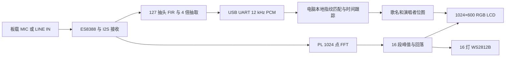

# 实现路径与算法

## 数据流和职责

主时钟来自独立的 50 MHz PL 振荡器，不需要 PS 初始化 FCLK。串口识曲支路观察音频采样，不向 FFT 和显示支路施加等待。主机退出时频谱和灯环逻辑仍独立运行；歌名文字按通信超时清除。

## 频谱与灯效

FFT IP 为 1024 点、16 位定点输入、非缩放、自然序输出，使用 RADIX-2 burst。对正频率 bin 按 16 个区间取峰值；显示量为 `abs(real)+abs(imag)`，经过移位、限幅与逐帧回落后用于屏幕高度和灯效。它是幅值近似，不是功率、响度或标定后的 dB。

按标称 48 kHz 计算，bin 间隔为 46.875 Hz。ROM 中 750 Hz 与 3000 Hz 对应 bin 16 和 64；NumPy 参考检查直接比较 FFT 复数结果，不拿显示近似代替 FFT 数值正确性。WS2812B 使用单线串行输出，帧中包含 16 个独立颜色，50 Hz 刷新。

## 本地听歌识曲

识曲输入为 FIR 抗混叠后抽取的 12 kHz PCM16。电脑去直流、重采样和检查低电平，在 1024 点 Hann 窗、128 点步进的短时频谱中抽取局部峰值，按锚点和目标峰值配对，把频率与时间差组成指纹。曲库为 SQLite，指纹建立索引；查询以同一录音的时间偏移形成投票聚类，并同时约束特征票数、独立锚点、覆盖时长、匹配比例与候选优势。

录入立体声时保存混合声道与左右声道视图的指纹并集，避免 FPGA 只传左声道而参考文件使用混合声道产生偏差。歌名与演唱者来自录入时确认的标签，不从文件名伪造查询结果。

## 状态保持和保护

实时查询先采集 8 秒窗口，再做一致性确认。MIC 的补充确认可累计同一候选的连续证据，要求候选时间偏移随真实 `sample_end` 推进，防止冻结或过期窗口形成新身份；相邻窗口重叠，不是多个独立录音样本。已确认歌曲可在有限时间内保持，但换歌、持续停声、模式变化和断线分别触发重置。规则代码与反例检查见 `src/pc/recognition_tracker.py` 和 `src/pc/test_recognition_tracker.py`。

曲库当前为小规模预录原版录音。未录入歌曲、不同翻唱与哼唱没有可靠识别保证。系统为电脑协助方案，不是完全脱离电脑的板端识曲。
